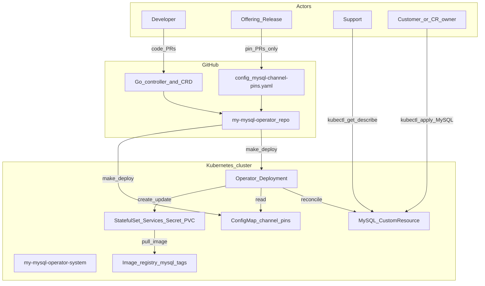
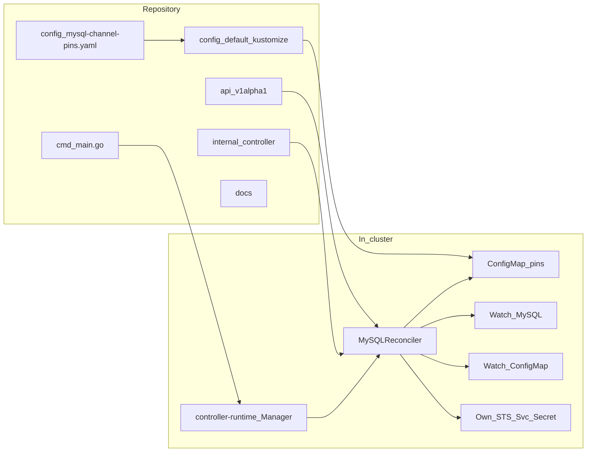
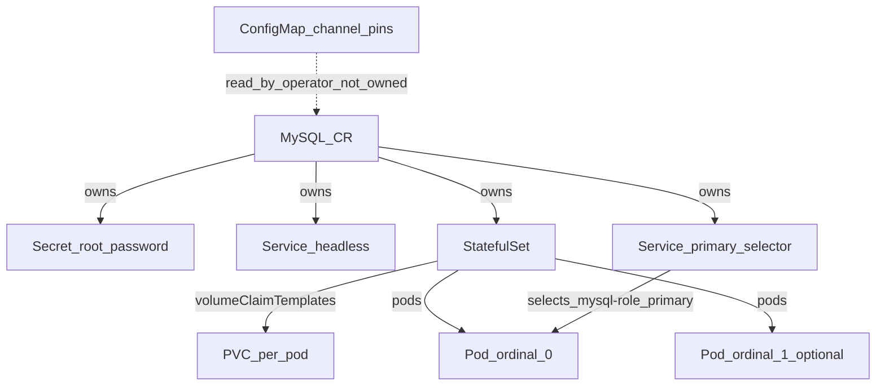
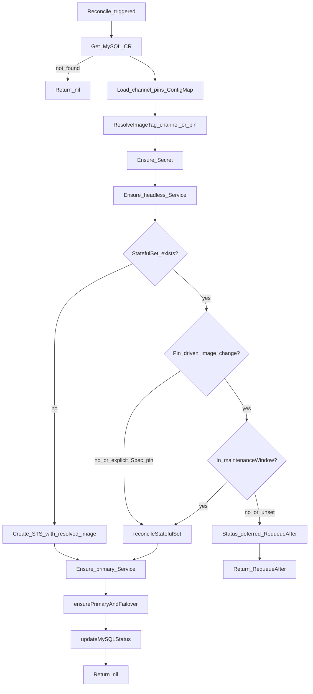
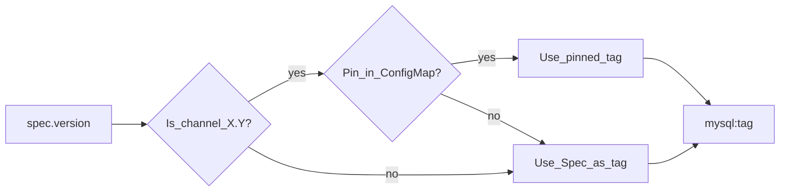
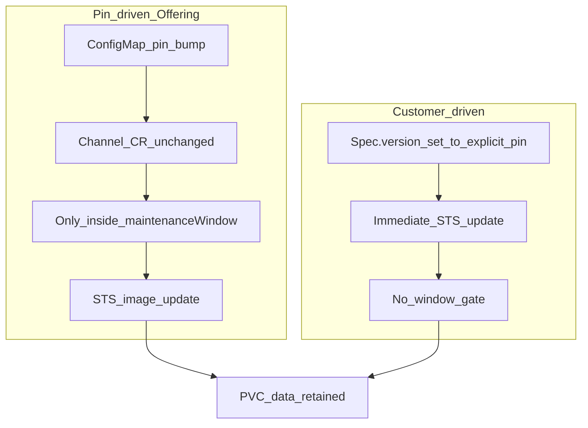
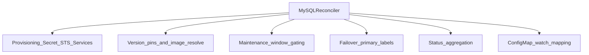
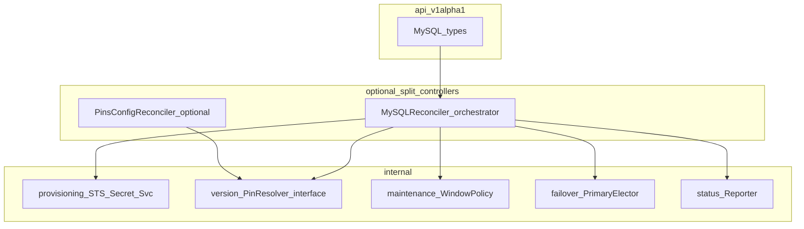
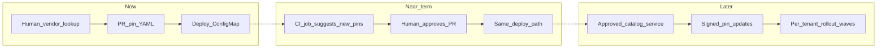

# Architecture and flows

**Audience:** Engineering walkthroughs, Offering/Support briefings, planning for automation and modularization.  
**Scope:** What exists in `my-mysql-operator` after R6 (channel pins + maintenance windows), plus pictorial “next steps.”  
**Related:** [mysql-version-and-upgrades.md](mysql-version-and-upgrades.md), [myreq/mysql-req.md](../myreq/mysql-req.md)

Diagrams use [Mermaid](https://mermaid.js.org/) (render in GitHub, many IDEs, and Mermaid Live Editor).

---

## 1. System context (today)

What surrounds the operator and how people / systems interact with it.



---

## 2. Repository and runtime layout (today)



| Area | Responsibility today |
|------|----------------------|
| `api/v1alpha1` | MySQL Spec/Status (version, storage, replicas, maintenanceWindow, status fields) |
| `internal/controller` | **Single** reconciler: provision + pins + window + failover labels + status |
| `config/mysql-channel-pins.yaml` | Offering-owned channel → patch map |
| `config/default` | Deploy operator, RBAC, CRDs, pins ConfigMap |

---

## 3. Owned cluster objects (per MySQL CR)



Naming: CR name is sanitized (`.` → `-`). Example: `my-mysql-8.4.x` → STS `my-mysql-8-4-x`, Service `my-mysql-8-4-x-service`.

---

## 4. Reconcile flow (today)

End-to-end path when a MySQL CR or pins ConfigMap changes.



### Image resolution detail



### Pin-driven vs customer-driven upgrade



---

## 5. Offering pin lifecycle (today)

```mermaid
sequenceDiagram
  participant Off as Offering_Release
  participant GH as GitHub
  participant Pipe as Deploy_make_deploy
  participant CM as ConfigMap
  participant Op as Operator
  participant STS as StatefulSet

  Off->>Off: Manual_vendor_lookup
  Off->>GH: PR_edit_pin_YAML_only
  GH->>GH: Merge
  Pipe->>CM: Apply_ConfigMap
  CM->>Op: Watch_enqueue_all_MySQL
  Op->>Op: Resolve_and_check_window
  alt Inside_window
    Op->>STS: Update_image
    STS->>STS: Roll_pods
  else Outside_window
    Op->>Op: Status_deferred_requeue
  end
```

---

## 6. Concerns mixed in one reconciler (today — maintainability view)

Useful for explaining **why** to modularize later.



| Concern | Today | Pain if it grows |
|---------|--------|------------------|
| Provisioning | Same file as everything else | Hard to test STS builders in isolation |
| Version / pins | `version_pins.go` helpers + reconcile gates | Still coupled to STS update path |
| Maintenance window | Inline in Reconcile | Policy changes touch main loop |
| Failover | `ensurePrimaryAndFailover` in same reconciler | HA will dominate file size / RBAC |
| Status | Large `updateMySQLStatus` | Competing status writers / messages |
| Offering config | ConfigMap watch | Fine for now; automation later |

---

## 7. Target modular shape (next — separation of concerns)

Proposed package / controller boundaries (not implemented yet).



**Suggested interfaces (illustrative):**

```text
PinResolver.Resolve(specVersion) (tag string, pinDriven bool, err)
WindowPolicy.AllowUpgrade(now, window) (ok bool, requeueAfter time.Duration)
Provisioner.Ensure(ctx, mysql, imageTag) error
PrimaryElector.Ensure(ctx, mysql) error
StatusReporter.Update(ctx, mysql, facts) error
```

Benefits: unit-test policies without envtest; Offering automation plugs into `PinResolver` without touching STS code; failover can become its own controller later.

---

## 8. Automation roadmap (pictorial)

From today’s **manual vendor lookup + PR** toward safer automation.



| Stage | What is automated | What stays human |
|-------|-------------------|------------------|
| **Now** | Reconcile, window gate, STS roll | Vendor lookup, pin PR, merge |
| **Near** | Detect newer tags / open draft PR | Approve pin PR, release timing |
| **Later** | Catalog, progressive rollout | Policy / exception approval |

**Constraint:** Do not skip the pin file / PR gate for production-like offerings unless product explicitly accepts fully automatic upgrades.

---

## 9. Walkthrough script (use with diagrams above)

1. **Context** — §1: actors, Git, cluster.  
2. **CR → objects** — §3: what a MySQL instance materializes.  
3. **Happy path create** — §4: reconcile without pin change.  
4. **Offering bump** — §5: edit pins → ConfigMap → window → roll.  
5. **Deferral** — §4: outside window / missing window.  
6. **Limits today** — §6: one reconciler, many concerns.  
7. **Where we’re going** — §7–§8: modules + automation stages.

---

## 10. Quick reference — code map

| Topic | Location |
|-------|----------|
| Entry / manager | `cmd/main.go` |
| API | `api/v1alpha1/mysql_types.go` |
| Reconcile + STS + failover + status | `internal/controller/mysql_controller.go` |
| Pins / window helpers | `internal/controller/version_pins.go` |
| Offering pin source | `config/mysql-channel-pins.yaml` |
| Deployed ConfigMap | `config/manager/mysql_channel_pins.yaml` |
| Version/upgrade narrative | `docs/mysql-version-and-upgrades.md` |

---

## 11. Document history

| Date | Note |
|------|------|
| 2026-11-08 | Initial architecture & flows after R6 merge (PR #1). |
